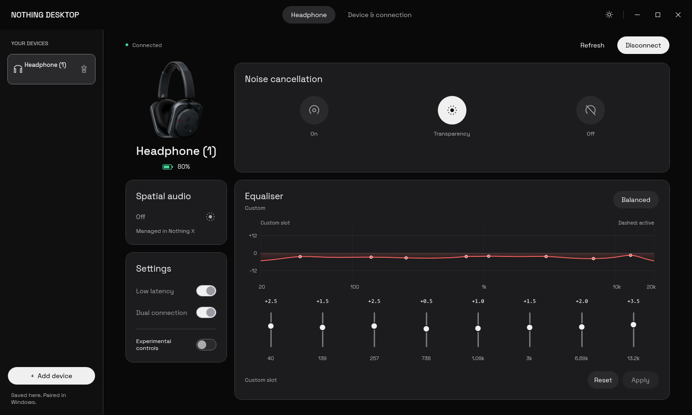
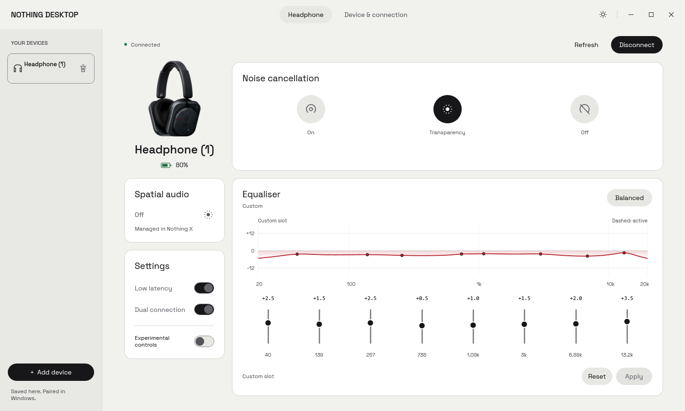

# Nothing X Desktop

An unofficial Windows desktop companion aiming to bring the Nothing X experience to Nothing and CMF devices. The project is evolving from a Headphone (1) companion into a multi-device app, with model-specific controls and a shared desktop experience.

**Full device support is the goal, not the current compatibility claim.** The current implementation is an early Windows WPF app (version 0.2.0) with a verified Headphone (1) integration. Other models need their own protocol, capability and hardware validation before they can be enabled safely.

## Screenshots

Headphone (1) connected in dark and light mode. Device identifiers are redacted.

### Dark mode



### Light mode



## Device support

| Device | Current status |
| --- | --- |
| Nothing Headphone (1) | Implemented; telemetry and an existing-mode ANC write were verified on real hardware with firmware 1.0.1.81. |
| Other Nothing headphones and earbuds | Planned; discovery and controls are not yet enabled for these models. |
| CMF devices and other device categories | Long-term scope; no compatibility has been validated yet. |

The current app deliberately filters discovery to Headphone (1). Removing that filter alone does not add support: different devices can use different transports, commands, battery layouts, EQ formats and supported features.

## Current features

- Discover and connect to a paired Headphone (1) through its Bluetooth Classic RFCOMM NT LINK service.
- Show battery and charging state, preferring valid Windows battery telemetry over potentially stale protocol readings. Both sources remain visible in diagnostics.
- Read firmware, ANC mode, EQ preset and stored custom EQ, spatial audio state, low-latency mode, multipoint state and codec preference.
- Change ANC, select Balanced EQ and edit an eight-band custom EQ draft. Custom EQ writes preserve the device's frequencies, filter types, Q values and preamp.
- Model the EQ filter response, switch between dark and light themes, and export diagnostics locally.

### Safety and limitations

- Custom EQ and optional setting writes are experimental and have not been hardware-validated. Low-latency and multipoint writes require the experimental controls to be enabled.
- EQ changes are blocked when spatial audio is enabled or its state is unknown.
- The EQ plot is a modeled filter response, not an audio spectrum or a measured acoustic response.
- Codec preference is read-only and does not identify the codec currently negotiated by Windows.
- Firmware updates, loud find-device playback and codec writes are not implemented.
- This is a Windows app, not a macOS or Linux build.

## Build and run

### Requirements

- Windows with Bluetooth support; the current native integration has been tested on x64.
- The .NET 8 SDK to build, including the Windows Desktop/WPF targeting components.
- The .NET 8 Desktop Runtime to launch the framework-dependent published app.
- A supported device paired in Windows Bluetooth settings.

Run these commands from the repository root in PowerShell:

```powershell
powershell -NoProfile -ExecutionPolicy Bypass -File .\build.ps1 -Test
.\run.cmd
```

`build.ps1` restores and publishes the app to `artifacts/Nothing.Desktop/`. It uses `.tools/dotnet/dotnet.exe` if present, otherwise `dotnet` from `PATH`. The local SDK is optional, ignored by Git and not downloaded automatically by the script.

`run.cmd` builds if the published executable is missing, then launches it with `--connect`. To launch without auto-connecting:

```powershell
.\artifacts\Nothing.Desktop\Nothing.Desktop.exe
```

Pair Headphone (1) in Windows first. For a Bluetooth control session, unplug USB-C, then use **Scan** and **Connect** if the device is not found automatically.

## Tests

The repository keeps its regression tests as source; generated results and screenshots are disposable.

### Build and regression suite

```powershell
powershell -NoProfile -ExecutionPolicy Bypass -File .\build.ps1 -Test
```

This runs the executable test harness in `tests/Nothing.Tests`, covering protocol framing and CRC, native Bluetooth ABI layout, battery source selection, and EQ encoding and response math. It does not require a connected device.

### UI smoke test

After building, run the real WPF window through its smoke-test harness without changing headphone listening settings:

```powershell
$app = Start-Process -FilePath .\artifacts\Nothing.Desktop\Nothing.Desktop.exe -ArgumentList '--smoke-test' -Wait -PassThru
if ($app.ExitCode -ne 0) { throw "UI smoke test failed: $($app.ExitCode)" }
Get-Content .\.agent_tmp\screenshots\smoke-results.txt
```

This checks the actual UI, title-bar actions, themes and layouts. An interactive Windows desktop is required. Screenshots and results go under `.agent_tmp/`.

### Optional hardware checks

With a paired Headphone (1), the following performs read-only telemetry checks:

```powershell
powershell -NoProfile -ExecutionPolicy Bypass -File .\build.ps1 -HardwareTest
```

To include real telemetry in the UI smoke test, add `--hardware-ui` alongside `--smoke-test`; output goes to `.agent_tmp/screenshots-live/`. This exercises local EQ drafts without applying them.

`build.ps1 -VerifyAncWrite` is **not read-only**: it explicitly re-applies the existing ANC mode and verifies the acknowledgement and read-back. Run it only when you intend to exercise a real device write.

## Multi-device direction

The goal is one Nothing X desktop app rather than separate apps per device. The next development stages are:

- Introduce device identities, profiles and per-model capability detection instead of hard-coded Headphone (1) assumptions.
- Separate shared connection and protocol handling from model-specific payloads and commands; add transport adapters where devices require them.
- Add Nothing and CMF models incrementally, including appropriate battery layouts, EQ formats and supported controls.
- Adapt the UI to the selected device and hide unsupported controls instead of offering unsafe generic writes.
- Expand regression coverage and record real hardware/firmware verification for each supported model.

Additional device categories remain part of the broader vision, but need separate investigation rather than being assumed compatible with the current audio protocol.

## Repository layout

```text
src/
  Nothing.Core/       Protocol framing, payload validation, battery and EQ logic
  Nothing.Desktop/    WPF UI, Windows Bluetooth integration and UI smoke tests
tests/
  Nothing.Tests/      Executable regression and optional hardware test harness
Nothing.sln          Solution entry point
Directory.Build.props Shared compiler settings
build.ps1            Restore, publish and optional tests
run.cmd              Build-if-needed launcher
```

Build outputs (`bin/`, `obj/`, `artifacts/`), local tooling (`.tools/`), test scratch data (`.agent_tmp/`), test results, logs, IDE user files and local environment secrets are ignored. Do not commit generated binaries, temporary test screenshots, device diagnostic exports or credentials. Recreate test outputs with the build and test commands rather than checking them in. Curated README screenshots live in `docs/screenshots/` and must have device identifiers redacted.

## Contributing device support

Include the exact model and firmware, supported capabilities, validated payload formats, and regression tests. Start with read-only discovery and telemetry before introducing acknowledged, read-back-verified writes. Never assume Headphone (1) commands or its eight-band EQ layout apply to another model.

Redact device addresses, serial numbers and other personal data from issue reports and captures. Keep the runtime dependency-light; there are currently no third-party runtime packages.

## License and attribution

The application source is licensed under the [MIT License](LICENSE). This is an independent, unofficial project, not affiliated with or endorsed by Nothing or CMF.

The protocol implementation was written independently using the [Nothing X for macOS protocol reference](https://github.com/Senooy/nothing-x-mac/blob/main/Protocol.md); no upstream source files were copied. EQ response math follows the [W3C Audio EQ Cookbook](https://www.w3.org/TR/audio-eq-cookbook/).

The bundled Headphone (1) product image in `src/Nothing.Desktop/Assets/Headphone.png` comes from Nothing's official product artwork. Nothing and CMF names, trademarks and product artwork belong to their respective owners; the source-code license does not grant rights to that branding or artwork.
